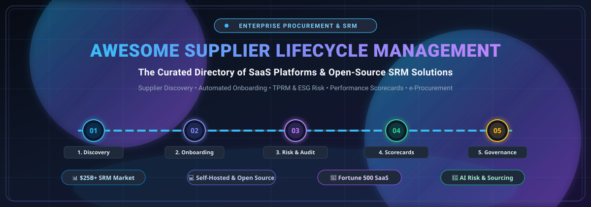
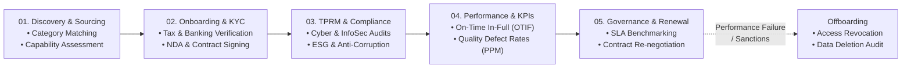

  

  
  
  
  
  
  

# 🌐 Awesome Supplier Lifecycle Management (SLM) & SRM Ecosystem

> **A comprehensive, SEO-optimized directory of enterprise SaaS platforms and self-hosted open-source software for Supplier Lifecycle Management (SLM), Supplier Relationship Management (SRM), Third-Party Risk Management (TPRM), and Procurement Lifecycle Automation.**

---

## 📑 Table of Contents

- [📌 Introduction & Overview](#-introduction--overview)
- [📈 Sector Overview & Market Dynamics](#-sector-overview--market-dynamics)
- [🏢 Enterprise SaaS Platforms](#-enterprise-saas-platforms)
- [💻 Open-Source GitHub Projects](#-open-source-github-projects)
- [🔄 Supplier Lifecycle Architecture & Stages](#-supplier-lifecycle-architecture--stages)
- [⚖️ Enterprise SaaS vs. Self-Hosted Open-Source Comparison](#️-enterprise-saas-vs-self-hosted-open-source-comparison)
- [❓ Frequently Asked Questions (FAQ)](#-frequently-asked-questions-faq)
- [🤝 How to Contribute](#-how-to-contribute)
- [⭐ Star History](#-star-history)
- [💖 Support & Community](#-support--community)
- [📜 Disclaimer](#-disclaimer)

---

## 📌 Introduction & Overview

**Supplier Lifecycle Management (SLM)** governs the 360-degree journey of supplier relationships within enterprise supply chains—from initial supplier discovery, pre-qualification, KYC/AML validation, and automated onboarding, to ongoing performance scorecards, ESG compliance monitoring, contract governance, and eventual offboarding.

Modern procurement organizations deploy SLM systems to eliminate vendor fraud, enforce regulatory compliance (e.g., CSDDD, GDPR, ISO/IATF standards), mitigate supply-chain disruption risks, and automate Source-to-Pay (S2P) operational overhead.

Whether your organization requires a tier-one **enterprise cloud suite** (SAP Ariba, ServiceNow, Coupa) or sovereign, customizable **self-hosted open-source SRM infrastructure** (Dolibarr, ITFlow, OpenGRC, mcp-supplier), this repository provides transparent feature matrices, concrete pricing benchmarks, and direct GitHub repositories.

---

## 📈 Sector Overview & Market Dynamics

The global **Supplier Relationship Management (SRM) and Supplier Lifecycle Management (SLM)** software market was valued at **$22.4 Billion in 2024** and is projected to surpass **$33.2 Billion by 2030**, expanding at a robust Compound Annual Growth Rate (**CAGR of 8.1% to 11.9%**).

The SLM sector exhibits a **moderately-to-highly fragmented market structure** rather than a single winner-take-all monopoly. While established multi-billion dollar enterprise ERP titans (such as SAP Ariba, ServiceNow, and Coupa) dominate large-scale Fortune 500 spend workflows, agile specialized SaaS challengers (such as TealBook for AI supplier data enrichment, Graphite Connect for rapid onboarding, and HICX for supplier experience management) capture substantial market share by targeting pain points around onboarding friction, data hygiene, and third-party risk. Concurrently, the rise of open-source and agentic LLM/MCP frameworks is democratizing sovereign procurement workflows for small-to-midsize enterprises.

---

## 🏢 Enterprise SaaS Platforms

The table below catalogs the leading commercial SaaS platforms for Supplier Lifecycle Management, **sorted in descending order by company scale** (Market Capitalization / Corporate Valuation). Each entry includes verified starting-tier pricing and concrete free-tier/trial terms.

| # | SaaS Platform | Company Scale (Valuation / Revenue) | Core SLM Capabilities | Starting Tier Pricing | Free Tier / Free Trial Limits |
|:---:|:---|:---|:---|:---|:---|
| **1** | [**SAP Ariba**](https://www.ariba.com/) 🌐 | **$245B Market Cap** *(SAP SE / ~$34B+ ARR)* | Enterprise supplier onboarding, global Ariba Network collaboration, AI-driven supplier risk tracking, automated RFQ workflows, and multi-tier contract compliance. | **$2,420 / month** *(~$29,040/year baseline Strategic Sourcing package; full S2P suites from $80,000/yr)* | **Free Forever Standard Account** for suppliers on SAP Business Network (unlimited transacting up to 4 documents/quarter or below fee thresholds); 30-day interactive guided buyer demo sandbox upon sales qualification. |
| **2** | [**ServiceNow SLM**](https://www.servicenow.com/) ⚡ | **$190B Market Cap** *(~$10B+ ARR)* | Built on the Now Platform; features Now Assist AI summarization, conversational vendor intake, multi-tier parent-subsidiary contact hierarchies, and automated SCAR corrective action plans. | **$100 – $200 / user / month** *(Billed annually; entry enterprise deployments typically start around $40,000/year)* | **Free ServiceNow Personal Developer Instance (PDI)** with full platform workflow and development tools (renewable upon activity); 30-day enterprise proof-of-concept (POC) sandbox for procurement evaluation. |
| **3** | [**Coupa BSM**](https://www.coupa.com/) 💳 | **$8.0B Valuation** *(~$800M+ ARR / Thoma Bravo)* | Unified Business Spend Management (BSM), automated vendor risk scoring, supplier information management (SIM), fraud prevention, and real-time PO/invoice synchronization. | **$1,250 – $2,083 / month** *(~$15,000 – $25,000/year for starter teams 1–10 seats; median enterprise suite ~$93,000/year)* | **Free Forever Coupa Supplier Portal (CSP)** Registered tier (unlimited PO receipts, e-invoicing & profile management for vendors); 14-day guided buyer demonstration sandbox environment. |
| **4** | [**GEP SMART**](https://www.gep.com/) 🧠 | **$2.5B+ Valuation** *(~$300M+ ARR)* | GEP Quantum Intelligence AI engine, direct & indirect supplier management, automated supplier qualification matrix, 360-degree scorecards, and unified source-to-contract. | **$4,166 / month** *(~$50,000/year for baseline configuration up to 5 power users; full suites starting at $75,000/year)* | **Free Forever Supplier Registration Portal** for invited vendors to maintain certifications and catalogues; 30-day guided enterprise testbed/POC environment for enterprise procurement teams. |
| **5** | [**JAGGAER**](https://www.jaggaer.com/) 🎯 | **$1.6B Valuation** *(~$250M+ ARR / Vista Equity)* | Direct materials supplier collaboration, modular Source-to-Contract (S2C), ESG risk evaluation, supplier qualification questionnaires, and supplier scorecard governance. | **$500 – $1,000 / month** *(~$6,000 – $12,000/year [£4,600–£9,200/yr] for entry-tier S2C user blocks; full enterprise suites from $165,000/year)* | **Free Forever Jaggaer Supplier Network** registration and catalog profile maintenance for vendors; 30-day customized enterprise demo environment and test tenant with pre-configured workflows. |
| **6** | [**Ivalua**](https://www.ivalua.com/) 🦄 | **$1.4B Valuation** *(~$180M+ ARR / Unicorn)* | Source-to-Pay suite with unified supplier repository, supplier diversity tracking, ESG sustainability auditing, 360-degree performance scorecards, and ERP integration. | **$12,500 / month** *(~$150,000/year baseline modular enterprise deployment; scales with spend volume and power users)* | **Free Forever Ivalua Supplier Portal** access for registered suppliers (unlimited RFQ participation, catalog uploads & document submission); 30-day structured POC sandbox for qualified buyer RFPs. |
| **7** | [**apexanalytix**](https://www.apexanalytix.com/) 🛡️ | **$1.0B+ Valuation** *(~$90M+ ARR / KKR backed)* | smartVM master data management, automated verification across 2B+ global supplier records, golden record creation, tax ID/bank validation, and fraud defense. | **$4,166 – $6,250 / month** *(~$50,000 – $75,000/year software platform; recovery audit available on a 15%–25% contingency fee model with $0 upfront)* | **Free Forever Vendor Portal** for suppliers submitting tax forms, banking verification, and compliance proofs; 30-day pilot risk assessment covering up to 500 supplier master records. |
| **8** | [**TealBook**](https://www.tealbook.com/) 🔍 | **$200M Valuation** *(~$20M+ ARR / Supplier.io)* | Autonomous AI supplier discovery, automated supplier data enrichment, diversity & ESG credential verification, supplier deduplication, and open API connectors. | **$1,666 – $2,916 / month** *(~$20,000 – $35,000/year for Growth tier data enrichment; Enterprise API tier starting from $60,000/year)* | **Free Supplier Search Preview** with up to 10 free supplier profile views; 14-day guided proof-of-concept enrichment pilot evaluating a sample slice of up to 1,000 supplier records. |
| **9** | [**Graphite Connect**](https://www.graphiteconnect.com/) 🔗 | **$70M Valuation** *(~$15M – $25M ARR)* | Collaborative supplier onboarding network, automated InfoSec and SOC2/ISO compliance reviews, vendor banking change fraud verification, and bidirectional ERP syncing. | **$2,083 / month** *(~$25,000/year flat-rate subscription for core onboarding & compliance; scales with ERP connector count)* | **Free Forever Graphite Network Profile** and self-service onboarding forever for all invited suppliers; 14-day interactive guided demo sandbox pre-loaded with standard supplier risk assessment templates. |
| **10** | [**HICX**](https://www.hicx.com/) 📊 | **~$80M Valuation** *(~$10M – $25M ARR)* | Supplier Experience Management (SXM), central vendor master data hub, low-code supplier onboarding workflow builder, and multi-ERP governance across SAP and Oracle. | **$8,333 / month** *(~$100,000/year enterprise subscription for core supplier information orchestration and master data)* | **Free Forever Supplier Self-Service Portal** for active vendors to maintain company profiles, tax certifications, and contact directories; 30-day structured proof-of-value (POV) evaluation sandbox. |

---

## 💻 Open-Source GitHub Projects

The following curated open-source projects provide sovereign, customizable alternatives for supplier relationship management, vendor risk management, procurement automation, and supplier scorecards.

Projects are **sorted in descending order by GitHub Stars_Count**, featuring active social badges directly linked to each repository's stargazers page:

1. **[Dolibarr ERP/CRM](https://github.com/Dolibarr/dolibarr)**  📦  
   *Enterprise-grade open-source ERP/CRM suite written in PHP.* Includes a comprehensive **Supplier Management Module** managing vendor directories, Approved Supplier Lists (ASL), multi-currency supplier price lists, purchase order revisions, supplier invoices, weighted supplier evaluations, and CAPA audit findings.

2. **[ITFlow](https://github.com/itflow-org/itflow)**  🖥️  
   *Self-hosted open-source IT service management and vendor management system.* Provides centralized **Vendor & Supplier Lifecycle Tracking**, vendor contract renewal alerts, SLA performance tracking, SSL/domain certificate expiry monitoring, client/vendor portals, and procurement expense logging.

3. **[OpenGRC](https://github.com/LeeMangold/OpenGRC)**  🛡️  
   *Open-source Governance, Risk, and Compliance (GRC) platform.* Features a robust **Third-Party Vendor Risk Management (TPRM)** module with vendor risk assessment questionnaires, compliance evidence uploads, ISO 27001 / SOC 2 / HIPAA control mapping, and vendor remediation tracking.

4. **[ForgeFlow](https://github.com/JayleeBot/ForgeFlow)**  🤖  
   *AI-powered email procurement agent.* Automates RFQ quote ingestion from supplier emails, parses complex commercial quotes using LLMs, standardizes line-item pricing, and generates side-by-side bid comparison matrices.

5. **[1688 CLI](https://github.com/superjack2050/1688-cli)**  🔍  
   *AI-agent friendly command-line tool for supplier sourcing and vendor evaluation.* Automates supplier search, factory background verification, product pricing inquiries, and order lifecycle management.

6. **[OpenProcurement API](https://github.com/openprocurement/openprocurement.api)**  🏛️  
   *The core open-source procurement API toolkit powering national e-procurement systems (such as Prozorro).* Supports open transparent tenders, reverse electronic auctions, vendor pre-qualification, multi-stage evaluations, and real-time public contract tracking.

7. **[Open mSupply](https://github.com/msupply-foundation/open-msupply)**  🏥  
   *Open-source supply chain software designed for healthcare and humanitarian logistics.* Features supplier quotation comparisons, tender awards, supplier master catalog indexing, and automated purchase order dispatching.

8. **[OmniSupply AI](https://github.com/Bhardwaj-Saurabh/OmniSupply-AI-Multi-Agent-Supply-Chain-Intelligence-Platform)**  ⚡  
   *Multi-agent supply chain intelligence platform.* Combines supplier datasets, delivery performance logs, and risk indicators to generate autonomous supply-chain decision support via LangChain and multi-agent orchestration.

9. **[Procurement AI Assistant](https://github.com/arunbalajiraju-proc/procurement-ai-assistant)**  🧠  
   *Open library of reusable AI skills and prompts for procurement teams.* Covers supplier qualification checks, contract risk clause analysis, supplier negotiation preparation, and supplier performance scorecard calculations.

10. **[Procuman Community Edition](https://github.com/procuman/procuman-community-edition)**  📋  
    *Free and open e-procurement extension for EspoCRM.* Delivers supplier relationship categorization, supplier product catalog mapping, purchase order creation with automated calculation engines, and PDF generation.

11. **[mcp-supplier](https://github.com/zavora-ai/mcp-supplier)**  🔌  
    *Full Supplier Relationship Management (SRM) platform built on the Model Context Protocol (MCP).* Features 34 specialized tools spanning supplier lifecycle states (`prospect` → `active` → `suspended` / `disqualified`), ISO/IATF/HACCP certification tracking, RFQ sourcing, quality audits with automated SCAR issuance, and on-time delivery (OTD) scorecards.

12. **[VendorBridge AI](https://github.com/vatsalgajera-tech/VendorBridge-AI)**  🚀  
    *AI-powered procurement ERP built with React, Node.js, and MongoDB.* Features vendor risk scoring, multi-vendor RFQ bidding, AI-assisted quotation comparison and ranking, multi-stage approval hierarchies, and PO generation.

13. **[Shillinq](https://github.com/ConductionNL/shillinq)**  📁  
    *Open-source Nextcloud business procurement and supplier qualification suite (EUPL-1.2).* Offers configurable supplier questionnaires, automated certificate expiry alerts, purchase order revision workflows, and a full-text searchable contract repository.

---

## 🔄 Supplier Lifecycle Architecture & Stages

A production Supplier Lifecycle Management system orchestrates 5 interdependent lifecycle phases:

1. **Discovery & Pre-Qualification**: Identifying prospective suppliers, matching category codes (UNSPSC, NAICS), and verifying baseline production capabilities.
2. **Onboarding & Vendor Master Data Management**: Collecting legal entities, automated tax ID checks (W-8/W-9), bank account ownership validation to prevent change-of-banking fraud, and ERP sync.
3. **Third-Party Risk Management (TPRM) & Compliance**: Evaluating cybersecurity posture (SOC 2, ISO 27001), corporate social responsibility (CSR / ESG), sanctions list screening (OFAC), and environmental certifications.
4. **Performance Measurement & Operational Scorecards**: Real-time aggregation of operational metrics including On-Time In-Full (OTIF) delivery, Parts Per Million (PPM) defect rates, invoice dispute ratios, and customer service responsiveness.
5. **Contract Governance, Tiered Growth & Offboarding**: Managing contract renewals, Volume rebate tracking, early-pay discounts, or structured offboarding with automated IT/physical access revocation.

---

## ⚖️ Enterprise SaaS vs. Self-Hosted Open-Source Comparison

| Dimension | Enterprise SaaS (e.g., SAP Ariba, Coupa, ServiceNow) | Self-Hosted Open-Source (e.g., Dolibarr, ITFlow, OpenGRC) |
|:---|:---|:---|
| **Deployment Speed** | 3–12 months (complex system integration & SI consulting) | Hours to days (Docker, Helm, or bare metal) |
| **Data Sovereignty** | Multi-tenant cloud hosted by SaaS vendor | 100% sovereign (on-premise, private VPC, air-gapped) |
| **Annual TCO** | $50,000 to $500,000+ (license fees + per-seat escalators) | $0 software licensing (infrastructure & internal ops only) |
| **Customizability** | Constrained to vendor SDKs and extension frameworks | Unlimited source code modification & tailored workflows |
| **Supplier Network Effects** | Pre-populated global supplier networks (millions of vendors) | Requires self-managed vendor onboarding and invitations |
| **Audit & Governance** | Out-of-the-box SOC1/SOC2, FedRAMP, and HIPAA certifications | Compliance relies on organization's infrastructure hardening |

---

## ❓ Frequently Asked Questions (FAQ)

### What is Supplier Lifecycle Management (SLM)?
Supplier Lifecycle Management (SLM) is the strategic, end-to-end discipline of managing an organization's interactions with third-party vendors—starting before contract signing and continuing through qualification, risk assessment, transaction execution, scorecard evaluation, and offboarding.

### How does SLM differ from traditional Procurement or ERP?
Traditional ERP and purchase-order systems focus primarily on transactional procurement (creating POs, receiving goods, paying invoices). In contrast, SLM focuses on **vendor relationship health, risk, and master data integrity**: verifying vendor legitimacy, preventing wire fraud, tracking quality scorecards, monitoring supply chain bottlenecks, and enforcing compliance certifications.

### What is Third-Party Risk Management (TPRM) in SLM?
TPRM evaluates risks introduced by outside vendors, including cybersecurity vulnerabilities, data privacy liabilities (GDPR, CCPA), financial instability, reputational exposure, and ESG supply chain violations (e.g., German Supply Chain Due Diligence Act / EU CSDDD).

### Can open-source software replace enterprise SaaS for SLM?
Yes, particularly for organizations seeking data sovereignty, budget predictability, or deep custom workflow integration. Pairing an open-source ERP like **[Dolibarr](https://github.com/Dolibarr/dolibarr)** or **[ITFlow](https://github.com/itflow-org/itflow)** with specialized GRC tooling like **[OpenGRC](https://github.com/LeeMangold/OpenGRC)** or agentic servers like **[mcp-supplier](https://github.com/zavora-ai/mcp-supplier)** delivers enterprise-grade vendor tracking without seat-based license lock-in.

---

## 🤝 How to Contribute

We welcome contributions from procurement engineers, vendor managers, and open-source contributors!

1. Fork this repository.
2. Add your suggested platform or project to [README.md](file:///C:/Users/hp/Documents/Projects/Awesome-Supplier-Lifecycle-Management-SLM/README.md) adhering to existing formats:
   - For **SaaS**: Include company scale, core capabilities, transparent starting pricing, and concrete free-tier/trial limits.
   - For **Open-Source**: Include official GitHub link, Shields.io social Stars_Badge linking to `/stargazers`, and a descriptive capability summary.
3. Submit a pull request with a brief summary of the changes.

---

## ⭐ Star History

---

## 💖 Support & Community

Thank you for exploring and supporting **Awesome Supplier Lifecycle Management (SLM)**! If you find this directory valuable for your organization, procurement architecture, or research:

- ⭐ **Star this repository** to show appreciation and boost its visibility for the global procurement and developer community.
- 🍴 **Fork the project** to curate your company's internal vendor playbook or contribute additions upstream.
- 📢 **Share with colleagues** in procurement, supply chain logistics, vendor risk management, and software engineering.
- ☕ **Sponsor the maintainer** / buy a coffee via the [GitHub Sponsor Dashboard](https://github.com/sponsors/ishandutta2007) to support continuous maintenance and curation of open developer resources!

---

## 📜 Disclaimer

- This directory is an independent, community-curated educational index and does not represent an endorsement of any listed vendor or platform.
- Pricing, tier terms, and corporate valuations fluctuate over time and reflect publicly available market benchmarks as of October 2026; always consult vendors directly for binding contractual quotes.
- Organizations implementing self-hosted open-source software must conduct independent security hardening, credential safeguarding, and compliance validation before handling sensitive financial or supplier master data.
- All product names, logos, and brands are property of their respective owners.
